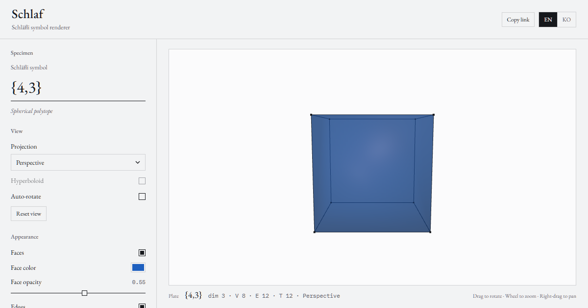

# Schlaf — 슐레플리 렌더러

[English](README.md) | **한국어**

[](https://jake1104.github.io/Schlaf/)
[](https://github.com/jake1104/Schlaf/releases)
[](LICENSE)

**라이브 렌더러 → [jake1104.github.io/Schlaf](https://jake1104.github.io/Schlaf/)**

슐레플리 기호를 입력하면 폴리토프를 렌더링합니다. 임의 차원, 유클리드·구면·쌍곡 공간, 원근·입체투영, 볼록·오목 도형을 지원합니다.



## 기능

- 다각형, 다면체, 4차원 폴리코라, 5차원 이상 폴리토프.
- 유클리드·구면·쌍곡 기하, 푸앵카레 원반·공 표현.
- Wythoff 연산자 `t`, `r`, `rr`, `tr`, `s` / `sr`, 프리즘·테굼·조인 곱.
- 별 다포체(`{5/2,5}`, `{5/2,3,3}` 등)와 별 허니컴.
- 원근·입체투영, 쌍곡 테셀레이션의 쌍곡면 리프트.
- 3D 회전·줌·이동, 고차원 평면 회전 슬라이더.
- 영어·한국어 인터페이스.
- 기호, 투영, 토글, 슬라이더, 면 스타일, 카메라를 복원하는 공유 URL.

## 예시

기호를 클릭하면 바로 열립니다.

| 기호 | 도형 |
|------|------|
| [`{4,3}`](https://jake1104.github.io/Schlaf/?s=%7B4%2C3%7D) | 정육면체 |
| [`{5/2,5}`](https://jake1104.github.io/Schlaf/?s=%7B5%2F2%2C5%7D) | 작은 별모양 십이면체 |
| [`{4,5}`](https://jake1104.github.io/Schlaf/?s=%7B4%2C5%7D) | 푸앵카레 원반의 쌍곡 테셀레이션 |
| [`{4,3,4}`](https://jake1104.github.io/Schlaf/?s=%7B4%2C3%2C4%7D) | 정육면체 허니컴 |
| [`{4,3,3}`](https://jake1104.github.io/Schlaf/?s=%7B4%2C3%2C3%7D) | 테서랙트 |
| [`{4,3}v()`](https://jake1104.github.io/Schlaf/?s=%7B4%2C3%7Dv%28%29) | 정사각뿔 |
| [`{5,3,3}`](https://jake1104.github.io/Schlaf/?s=%7B5%2C3%2C3%7D) | 600-셀 |

## 문법

| 형식 | 예 | 의미 |
|------|-----|------|
| `{p,q,...}` | `{4,3}`, `{5/2}`, `{4.5}` | 정다포체 기호, 별 `{n/d}`, 소수 허용 |
| 연산자 접두사 | `t{4,3}`, `r{4,3}`, `s{4,3}` | 절단, 절반화, 스너브 |
| `tr`, `rr`, `sr` | `tr{4,3}`, `sr{4,3}`, `rr{3,3}` | 옴니절단, 캔텔레이션, 스너브 |
| `A x B` | `{4}x{}`, `{}x{}` | 직교 프리즘 곱. `{}`는 단위 선분 |
| `{2}` | `{2}`, `{2}x{2}` | 두 꼭짓점을 가진 선분 |
| `A + B` | `{3}+{4}`, `{}+{}` | 테굼(쌍뿔) 합 |
| `A v B` | `{4,3}v()`, `{}v()` | 조인. `()`는 점, `{}`는 선분 |
| `{}` | `{}`, `x` / `+` / `v` 안 | 단위 선분 |
| `()` | `()` | 점, 조인의 꼭대기 |

입력 예: `{3,3}`, `{4,3,3}`, `t{4,3}x{}`, `{4,3}v{3,3}`, `{4,4}`, `{4,5}`, `{4,3,4}`, `{4,3,5}`

## 조작

- **좌드래그**: 3D 회전
- **휠**: 줌
- **우드래그**: 이동
- **XW / YW / ZW**: 고차원 평면 회전
- **보기 초기화**: 현재 도형에 맞게 카메라 재설정

**링크 복사**는 기호, 투영, 쌍곡면, 토글, 범위, 고차원 각도, 면 색상·불투명도, 카메라 위치를 모두 URL에 담아 복사합니다.

## 언어

영어가 기본이며 헤더의 **EN / KO** 스위치로 한국어로 전환할 수 있습니다. 선택은 기억되며, `?lang=ko` 또는 `?lang=en`을 붙이면 해당 언어로 열립니다.

## 동작 원리

### 분류

그람 행렬로 유한 다포체, 유클리드 테셀레이션, 쌍곡 테셀레이션을 구분합니다. `{4,3}`은 정육면체, `{4,4}`는 평면 정사각 테셀레이션, `{4,5}`는 푸앵카레 원반 위의 쌍곡 테셀레이션입니다. 유클리드 테셀레이션은 실제 면을 가진 평면 패치로, 쌍곡 테셀레이션은 측지선 면으로 그립니다. 푸앵카레 원반은 등각 사상이라 작은 타일은 유클리드처럼 보입니다.

### Wythoff 위치

연산자 접두사는 반사군의 Wythoff 위치를 고릅니다. `''`(정다포체), `t`(절단), `r`(절반화), `rr`(캔텔레이션), `tr`(옴니절단), `s`/`sr`(스너브)을 지원합니다. 생성점은 링이 있는 거울까지의 부호 거리가 같은 점으로, 유클리드 rank 3에서는 기본 삼각형 모서리에서, 쌍곡 rank n에서는 민코프스키 직교계 $\langle A_i, x\rangle = b_i$에서, 구면 rank n에서는 $A_i\cdot x = b_i$에서 풉니다.

스너브 생성점은 다섯 회전 이미지 이웃까지의 거리가 같은 내부 점입니다. 유클리드 rank 3에서는 $\rho_0 = \rho_1\sin(\pi/p) = \rho_2\sin(\pi/q)$로 정확히 풀고, 그 이상은 반사 분기로 처리합니다. `tt`, `rt`처럼 `t`/`r`만 쌓은 연산자는 정확한 기반 위에 순차 적용하며, 균일 다포체가 될 수 없어 "근사 비균일"로 표시합니다.

### 고차원

4차원 구면군은 `[p,q,r]`의 콕서터 그람 행렬로 같은 선형계를 풉니다. 생성점의 궤도가 꼭짓점 집합이고, 최소 거리 그래프가 간선입니다. `{5,3,3}`(600/1200), `{3,3,5}`(120/720), `{3,4,3}`(24/96) 같은 정폴리코라와 `t{5,3,3}`(2400/4800), `rr{5,3,3}`, `tr{5,3,3}`(14400/28800)이 렌더링됩니다. 큰 모델은 와이어프레임으로 대체됩니다.

별 기호 `p/q`는 같은 그람 행렬의 $-\cos(\pi q/p)$ 항으로 처리합니다. `{5/2,3,3}`, `{5/2,3,5}`, `{5/2,5,3}` 같은 오목 별 폴리코라가 렌더링되고, `{5/2,5/2,5}`·`{3,5/2,5/2}`처럼 별 반사군이 무한인 경우 유한 핵 골격으로 근사합니다. 5차원 이상 정수 기호는 정확히 계산합니다: `{4,3,3,3}`(5-큐브 32/80), `{3,3,3,3}`(5-심플렉스 6/15).

### 별 다면체

`{5/2,5}`, `{5,5/2}`, `{5/2,3}`, `{3,5/2}`는 `[5,3]`의 Wythoff 모서리 궤도로 정확한 꼭짓점 집합을 얻습니다. 면은 공면 5-집합과 5+5 거리 패턴으로 찾고, 30개의 같은 길이 간선과 각 간선이 두 면에 공유되는지 검증합니다. 오각별 면은 내부 교차점을 공유하며 삼각분할합니다.

수학적 세부 사항과 전체 구현 설명은 [English README](README.md)를 참고하세요.

## 개발

Node.js 22+가 필요합니다.

```bash
npm install
npm run dev
npm test
npm run build
```

`npm run build`는 `dist/`에 정적 사이트를 생성합니다.

## 기여

이슈와 풀 리퀘스트를 환영합니다. 코드 변경은 다음 순서로 진행해 주세요.

1. 저장소를 포크하고 `main`에서 브랜치를 만듭니다.
2. `npm install` 후 변경하고, `tests/`에 테스트를 추가하거나 수정합니다.
3. `npm test`와 `npm run build`를 실행합니다.
4. 영향을 받은 기호나 동작을 설명하는 풀 리퀘스트를 엽니다.

기하 엔진은 결정적으로 유지하고, 버그 수정에는 실패하는 테스트를 함께 포함해 주세요.

## 라이선스

MIT © 2026 jake1104. [LICENSE](LICENSE)를 참고하세요.
