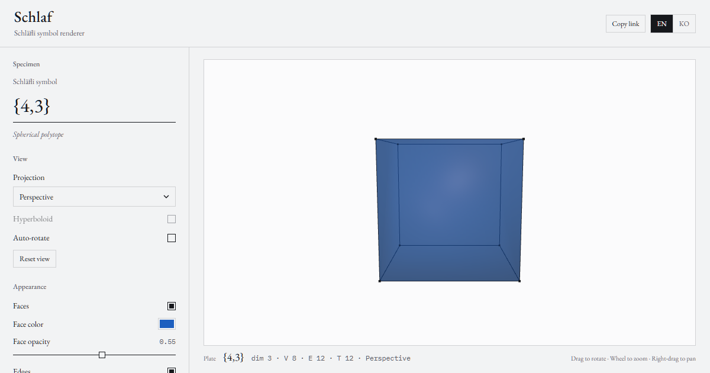

# Schlaf — Schläfli renderer

**English** | [한국어](README.ko.md)

[](https://jake1104.github.io/Schlaf/)
[](https://github.com/jake1104/Schlaf/releases)
[](LICENSE)

**Live renderer → [jake1104.github.io/Schlaf](https://jake1104.github.io/Schlaf/)**

Type a Schläfli symbol and get the polytope. Any dimension, Euclidean / spherical / hyperbolic, perspective / stereographic projection, convex / concave.



## Features

- Any rank: polygons, polyhedra, polychora and higher-dimensional polytopes.
- Euclidean, spherical and hyperbolic geometry, including Poincaré disk and ball views.
- Wythoff operators `t`, `r`, `rr`, `tr`, `s` / `sr`, plus prism, tegum and join products.
- Regular star polytopes (`{5/2,5}`, `{5/2,3,3}`, …) and star honeycombs.
- Perspective and stereographic projections; optional hyperboloid lift for hyperbolic tilings.
- 3D orbit, zoom, pan and higher-dimensional rotation sliders.
- English and Korean interface.
- Shareable URLs that restore the symbol, projection, toggles, sliders, face style and camera.

## Examples

Open any symbol directly in the renderer:

| Symbol | Shape |
|--------|-------|
| [`{4,3}`](https://jake1104.github.io/Schlaf/?s=%7B4%2C3%7D) | Cube |
| [`{5/2,5}`](https://jake1104.github.io/Schlaf/?s=%7B5%2F2%2C5%7D) | Small stellated dodecahedron |
| [`{4,5}`](https://jake1104.github.io/Schlaf/?s=%7B4%2C5%7D) | Hyperbolic tiling in the Poincaré disk |
| [`{4,3,4}`](https://jake1104.github.io/Schlaf/?s=%7B4%2C3%2C4%7D) | Cubic honeycomb |
| [`{4,3,3}`](https://jake1104.github.io/Schlaf/?s=%7B4%2C3%2C3%7D) | Tesseract |
| [`{4,3}v()`](https://jake1104.github.io/Schlaf/?s=%7B4%2C3%7Dv%28%29) | Square pyramid |
| [`{5,3,3}`](https://jake1104.github.io/Schlaf/?s=%7B5%2C3%2C3%7D) | 600-cell |

## Syntax

| Form | Example | Meaning |
|------|---------|---------|
| `{p,q,...}` | `{4,3}`, `{5/2}`, `{4.5}` | Regular symbol, star `{n/d}`, decimals allowed |
| op prefix | `t{4,3}`, `r{4,3}`, `s{4,3}` | Wythoff position of the triangle group: truncate, rectify, snub |
| `tr`, `rr`, `sr` codes | `tr{4,3}`, `sr{4,3}`, `rr{3,3}` | Wythoff positions: omnitruncate, cantellate, snub |
| `A x B` | `{4}x{}`, `{}x{}` | Cartesian prism product. A bare `{}` inside `x` reads as a unit segment, so `{}x{}` is a square |
| `{2}` digon | `{2}`, `{2}x{2}` | Segment with 2 verts; `{2}x{2}` is a square |
| `A + B` | `{3}+{4}`, `{}+{}` | Tegum (bipyramid) sum. A bare `{}` reads as a unit segment, so `{}+{}` is a diamond and `{4}+{}` an octahedron. Diameters never become edges |
| `A v B` | `{4,3}v()`, `{}v()`, `{}v{}` | Join. Bare `{}` is a unit segment, `()` is a point: `{}v{}` is a disphenoid, `{}v()` a triangle, `{4,3}v()` a pyramid |
| `{}` | `{}` alone, in `x` / `+` / `v` | Unit segment (1-ball). Bare braces always read as a segment, never special-cased per operator |
| `()` | `()` | Point (0-ball). Join apex / degenerate factor. `{4,3}v()` is a pyramid |

Input examples: `{3,3}`, `{4,3,3}`, `t{4,3}x{}`, `{4,3}v{3,3}`, `{4,4}`, `{4,5}`, `{4,3,4}`, `{4,3,5}`

## Controls

- **Left-drag**: rotate the projected 3D view
- **Wheel**: zoom
- **Right-drag**: pan
- **XW / YW / ZW**: rotate higher-dimensional planes
- **Reset view**: re-frame the current polytope

**Copy link** in the header copies the complete view state to the clipboard: symbol, projection, hyperbolic lift, toggles, range, higher-dimensional angles, face color, opacity, camera and target. The URL bar stays in sync as controls change.

## Languages

The interface is available in English (default) and Korean. Use the **EN / KO** switch in the header; the choice is remembered. Add `?lang=ko` or `?lang=en` to a link to open it in a specific language.

## How it works

### Classification

A symbol is classified by its Gram matrix (positive definite → finite polytope, semidefinite → euclidean tiling/honeycomb, otherwise hyperbolic). For rank 3 this is the $(p-2)(q-2) \lesseqgtr 4$ rule shown in the note line: `{4,3}` is a cube, `{4,4}` a flat square tiling, `{4,5}` a hyperbolic tiling drawn in the Poincaré disk, `{4,3,4}` the cubic honeycomb, `{4,3,5}` a hyperbolic honeycomb drawn in the Poincaré ball. Euclidean tilings are exact patches with real faces; hyperbolic tilings get filled geodesic faces (left-hand rule extraction, arc subdivision), honeycombs use planar-cycle faces (best-effort near the cutoff). The Poincaré disk is a flat conformal map (small tiles look Euclidean, which is correct); checking the hyperboloid lift puts the tiling onto the hyperboloid sheet in 3D so the negative curvature is visible.

### Wythoff positions

An op prefix selects a Wythoff position of the reflection group, derived from the orbit of one generator point — no coordinate tables. Valid codes are `''` (regular), `t` (truncate), `r` (rectify), `rr` (cantellate), `tr` (omnitruncate), `s` / `sr` (snub). The generator is the point whose signed distances to the ringed mirrors are equal, which is a linear system: in Euclidean rank 3 it is solved from the fundamental triangle corners, in hyperbolic rank n from the Minkowski-orthogonal system $\langle A_i, x\rangle = b_i$, and in spherical rank n from $A_i\cdot x = b_i$ (one equation per mirror; `0` for unringed mirrors).

The snub generator is the interior point whose five rotation-image neighbours are equidistant. For Euclidean rank 3 this has the closed form $\rho_0 = \rho_1\sin(\pi/p) = \rho_2\sin(\pi/q)$, solved exactly; higher ranks stay on the reflective branch. Snub vertices are always the even-parity orbit (rotation subgroup). Stacks of only `t`/`r` (`tt`, `rt`, ...) fall back to generic sequential application on the exact regular base — they exist as solids but cannot be uniform, and carry a "best-effort non-uniform" tag. Codes with no generic meaning (`ts`, `st`, `ss`, `s` on polygons) throw, naming the uniform codes.

### Tiling operators

The same Wythoff positions operate on tilings. Euclidean `[4,4]`, `[6,3]` (and `[3,6]` normalized to `[6,3]`) use the affine reflection orbit in the plane, capped by radius; hyperbolic `[p,q]` use the Lorentz orbit in the Poincaré disk, capped by word depth. Faces come from the planar graph (`fillFaces2D` on Klein coordinates for hyperbolic patches, so geodesic edges stay straight). This yields `t{6,3}` = 3.12.12, `r{6,3}` = 3.6.3.6, `rr{6,3}`, `tr{6,3}` = 4.6.12, `s{6,3}` = 3.6.3.6, `s{4,4}` = 3.3.4.3.4, and their hyperbolic counterparts (`t{4,5}`, `r{5,4}`, `tr{7,3}`, `s{4,5}`). Hyperbolic honeycombs accept the same prefixes in the Poincaré ball (`t{4,3,5}`, `r{4,3,5}`, `tr{4,3,5}`), with planar-cycle faces near the cutoff.

### Higher dimensions

Rank-4 spherical groups use the same linear system with the Coxeter Gram matrix of `[p,q,r]`; the orbit of the generator is the vertex set and its minimum-distance graph the edges. Regular polychora therefore come out directly: `{5,3,3}` (600 vertices, 1200 edges), `{3,3,5}` (120 / 720), `{3,4,3}` (24 / 96). Op prefixes ring nodes of the 4-node diagram, so `t{5,3,3}` (2400 / 4800), `r{5,3,3}`, `rr{5,3,3}` and `tr{5,3,3}` (14400 / 28800) all render; large ones fall back to wireframe with a note.

Fractional entries use the star order $p/q$ in the same Gram matrix ($-\cos(\pi q/p)$), so concave regular star polychora also render: `{5/2,3,3}` (600 / 1200), `{3,3,5/2}` (120 / 720), `{5/2,3,5}`, `{5/2,5,3}`, `{5,3,5/2}`, `{5/2,5,5/2}`, `{5,5/2,3}`, `{3,5/2,5}`. Two star symbols (`{5/2,5/2,5}`, `{3,5/2,5/2}`) have an infinite star reflection group; they fall back to the finite core skeleton (120 verts) and are tagged as approximated. Star polychora take their face polygons from the planar cycles of the star skeleton (no supporting-plane test), using the numerator of $p/q$ as the face size, so `{5,3,5/2}` renders its 720 pentagons instead of dropping to wireframe.

Regular star polytopes exist only up to dimension 4, but H^4 carries four regular star honeycombs: `{5/2,5,3,3}`, `{3,3,5,5/2}`, `{5,5/2,5,3}`, `{3,5,5/2,5}`. Their star Gram has a negative last pivot, so the Lorentz engine renders them in the Poincaré ball. Other star entries above 4D (`{5/2,3,3,3}`) are neither positive definite nor hyperbolic and throw. Integer higher-dimensional symbols stay exact: `{4,3,3,3}` (5-cube, 32 / 80), `{3,3,3,3}` (5-simplex, 6 / 15), `{5,3,3,3}` (hyperbolic 4-honeycomb, Poincaré ball).

`t` on polygons and 4D polytopes still cuts each vertex at distance $x$ along every incident edge, with $x$ solved from edge-length equality $L - 2x = 2x\sin(\theta/2)$:

$$x = \frac{L}{2 + 2\sin(\theta/2)}$$

$L$ is the shortest edge and $\theta$ the smallest angle between incident edges at a vertex.

### Kepler star polyhedra

`{5/2,5}`, `{5,5/2}`, `{5/2,3}`, `{3,5/2}` resolve to exact vertex sets (Wythoff corner orbits of `[5,3]`). Faces are found as coplanar 5-sets with a 5+5 distance pattern and validated (30 edges, uniform length, correct vertex degree, each edge shared by 2 faces). Pentagram faces are triangulated with computed inner crossings shared between adjacent faces (`{5/2,5}` → 12 corners + 20 crossings, `{5/2,3}` → 20 corners + 12 crossings), pentagon faces by fan, `{3,5/2}` triangles directly.

### Rectification

`r` threads edge topology instead of re-inferring it from distances: midpoints plus one vertex-figure cycle per original vertex (angle-sorted in 3D).

### Uniform operator solids

`t`, `r`, `rr`, `tr`, `s` / `sr` on `{4,3}` / `{3,4}` / `{3,3}` / `{5,3}` / `{3,5}` are finite triangle-group orbits, so every face is a regular polygon: `tr{4,3}` is the great rhombicuboctahedron (48 verts, 72 edges), `rr{4,3}` the small rhombicuboctahedron (24 / 48), `sr{4,3}` and `s{4,3}` the snub cube (24 / 60), `s{3,3}` the icosahedron, `sr{5,3}` and `s{5,3}` the snub dodecahedron (60 verts, 150 edges), `tr{5,3}` the great rhombicosidodecahedron (120 / 180), `tr{3,3}` the truncated octahedron, `rr{3,3}` the cuboctahedron.

### Spherical tilings

`{p,2}` dihedra render as two hemispherical caps over the equatorial `p`-gon (the equator stays the only tiling edge, the cap interior is a triangulated dome), and `{2,q}` hosohedra as `q` meridian lunes between the two poles (`{2,1}` is a single meridian plus sphere, `{1,2}` a loop with two disk faces). All patch triangles are oriented outward, so the sphere is not rendered inside out. Impossible symbols (`{1,3}`, `{3,1}`, `{1,1}`, `{4,0}`, `{5/0}`, `{0,3}`) show a "does not exist" message and clear the viewport.

## Development

Requires Node.js 22+.

```bash
npm install
npm run dev
npm test
npm run build
```

`npm run build` writes the static site to `dist/`.

## Contributing

Issues and pull requests are welcome. For code changes:

1. Fork the repository and create a branch from `main`.
2. Run `npm install`, make the change, and add or update tests in `tests/`.
3. Run `npm test` and `npm run build`.
4. Open a pull request describing the symbol or behavior affected.

Keep the geometry engine deterministic, and include a failing test for a bug fix.

## License

MIT © 2026 jake1104. See [LICENSE](LICENSE).
